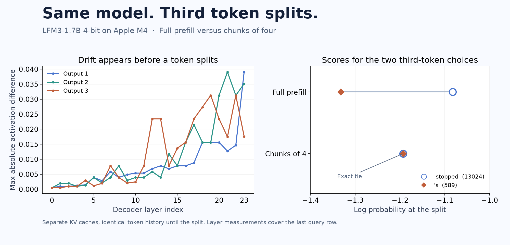

# inference-diff

Find the first token where two local inference configurations disagree. Run the same prompt through both paths, compare decoder activations and logits on their shared token history, and save the evidence as JSON.

## Try the example

The reference run uses Apple Silicon, Python 3.12, and the 4-bit LFM3-1.7B MLX checkpoint. The exact environment was tested on an Apple M4. Downloading the checkpoint requires about 1 GB of disk space in addition to the Python environment.

From this directory:

```bash
uv venv --python 3.12
uv pip sync --python .venv/bin/python requirements-m4.txt
.venv/bin/hf download LiquidAI/LFM3-1.7B-MLX-4bit \
  --revision 91f34088d6946482cbcae11b85d4657093618c34 --local-dir model
.venv/bin/python inference-diff --model model \
  --prompt 'Continue this story in one paragraph: When the clock stopped, the room went quiet.' \
  --left-chunk 0 --right-chunk 4 --tokens 32 --output split.json
```

If you already have the checkpoint, pass its path to `--model` and skip the download. Omit `--output` for JSON on stdout. With an output file, the CLI prints a short summary. A chunk size of `0` sends the prompt as one chunk.

On the reference M4 run, the first two generated tokens match. At zero-based position 2, full prefill chooses ` stopped` (13024) and chunk-4 chooses `'s` (589). The chunk-4 path has an exact top-two logit tie at that step. Both runs use the same checkpoint. The first measured decoder output difference appears at layer 0 during the forward for the first generated token.

## Inspect the evidence



| Run | Result |
|---|---|
| [Prefill split](examples/split.json) | First token split at position 2 |
| [Identical-settings control](examples/control.json) | 32 matching tokens with zero observed drift |
| [Drift with matching tokens](examples/drift.json) | Layer and logit differences with 16 matching tokens |

For the control, change `--right-chunk` to `0` and write to `control.json`. For the third case, use the prompt `Write one sentence about an astronaut repairing a solar panel.` and `--tokens 16`. See the [validation receipt](examples/validation.json) for device, versions, and sample hashes.

The JSON reports checkpoint checksums, actual device and dependency versions, prompt IDs, both selected tokens, full-vocabulary logit and log-probability differences, and per-layer maximum absolute activation differences. Layer measurements cover the last query row of each observed forward pass. The first changed layer identifies an observation boundary. Causes inside that layer require a separate trace. Comparisons stop as soon as the generated token histories split. Timing from the instrumented path is unsuitable for performance benchmarking.

The tested comparison is one checkpoint under two prefill settings. An experimental `--right-model` flag accepts another compatible LFM3 MLX checkpoint with the same tokenizer, prompt IDs, EOS IDs, and layer layout. Different weights, other model architectures, and other devices have no published validation here.

Code is [MIT licensed](LICENSE). The [checkpoint](https://huggingface.co/LiquidAI/LFM3-1.7B-MLX-4bit) is distributed by Liquid AI under its own terms. This source bundle contains code and example JSON. It contains zero model weights.
